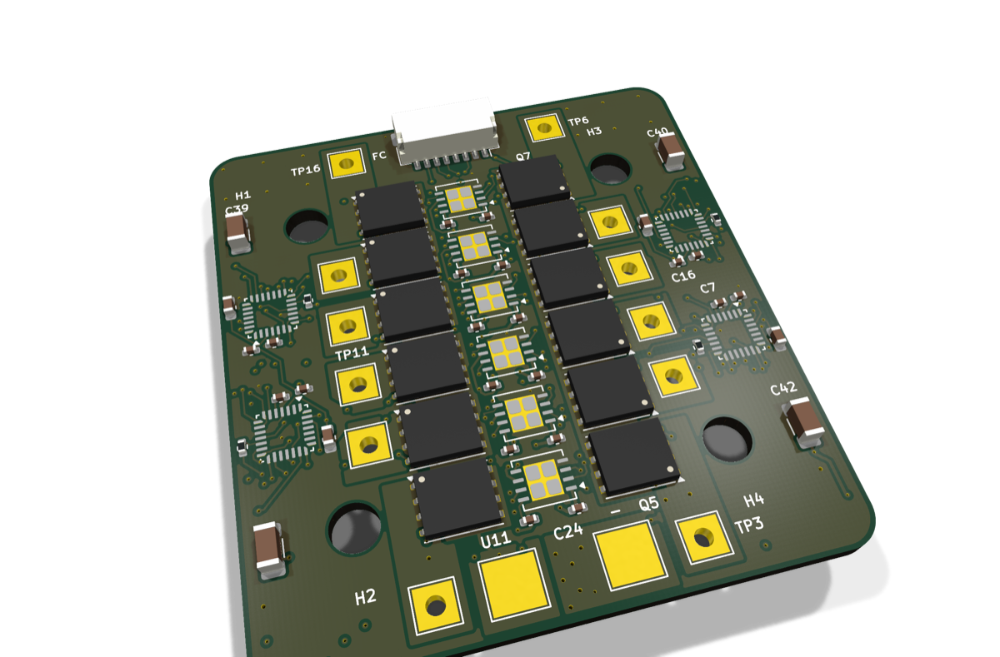
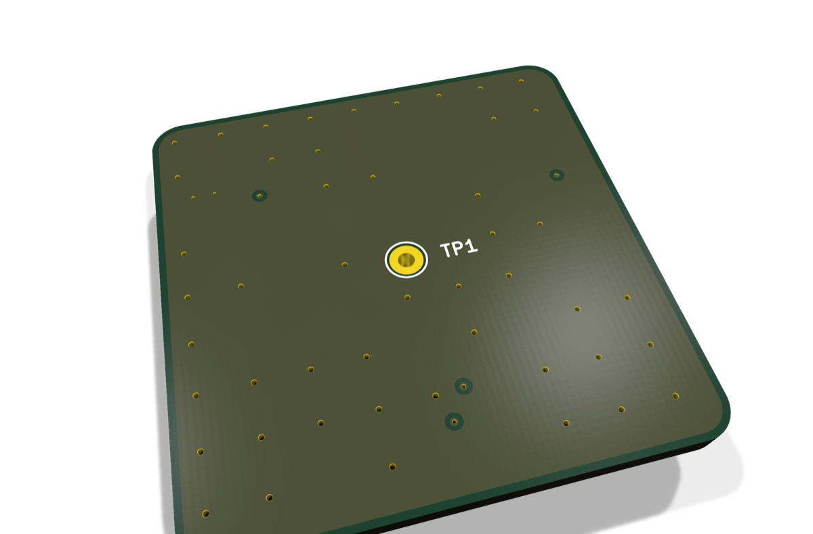

# Kestrel

**Open-hardware electronics for a 5-inch 6S FPV quad: a flight controller, a 4-in-1 ESC and a GPS,
designed in KiCad 10 and DRC clean.**

<table><tr>
<td align="center" width="33%"> <b><a href="https://github.com/HeyPCB/kestrel-fc">Kestrel H7</a></b> FPV flight controller</td>
<td align="center" width="33%"> <b><a href="https://github.com/HeyPCB/kestrel-esc">Kestrel 4in1</a></b> 6S 4-in-1 ESC</td>
<td align="center" width="33%"> <b><a href="https://github.com/HeyPCB/kestrel-gps">Kestrel GPS</a></b> GNSS and compass module</td>
</tr></table>

Three boards, plus the most common off-the-shelf modules every FPV build already buys (a digital HD VTX,
an ExpressLRS receiver, 22xx motors, 5-inch props and a 6S pack):

* **[Kestrel H7](https://github.com/HeyPCB/kestrel-fc)** (FPV flight controller, 40 x 40 mm, 6 layers): An STM32H743 flight controller for 5-inch 6S quads: two IMUs, a barometer, a 16 MB blackbox and its own 5 V and switchable 10 V BECs, on a 30.5 mm stack.
* **[Kestrel 4in1](https://github.com/HeyPCB/kestrel-esc)** (6S 4-in-1 ESC, 48 x 52 mm, 6 layers): Four STM32G071s running stock AM32, twelve half-bridge drivers and twenty-four 60 V FETs stacked through a 48 x 52 mm board, with battery current sensing for the flight controller.
* **[Kestrel GPS](https://github.com/HeyPCB/kestrel-gps)** (GNSS and compass module, 28 x 28 mm, 4 layers): A u-blox MAX-M10S under a 25 mm ceramic patch, with an LIS3MDL compass, on a 28 x 28 mm board that plugs 1:1 into the Kestrel H7.

| | |
|---|---|
| [`SPEC.md`](SPEC.md) | the system, each board's design, why each part, and what is not done |
| [`BUILD.md`](BUILD.md) | the off-the-shelf parts, the harnesses, the FC's pad map, ordering and first power-up |
| [`BOM.md`](BOM.md) | the whole drone's parts; [`costs/`](costs/) prices each board's BOM line by line |
| [`RESULTS.md`](RESULTS.md) | measured: ERC, routing, DRC, DFM, fab gate and parts cost per board |
| Firmware | a Betaflight target in [kestrel-fc](https://github.com/HeyPCB/kestrel-fc/tree/main/firmware/betaflight/KESTRELH7); stock AM32 on the ESC, mapped in [kestrel-esc](https://github.com/HeyPCB/kestrel-esc/blob/main/firmware/am32/README.md) |

**Not fabricated, assembled, powered or flown yet.** `SPEC.md` says what each claim rests on, and every
number in `RESULTS.md` is read from the boards' own reports.

## How it was made

Designed with the HeyPCB method on KiCad 10.0.6, headless, by the `heypcb-kicad` pipeline: a written brief composed from reusable circuit blocks, every pin from KiCad's own symbol library, every part bound to an LCSC number from a dated catalogue read, then ERC, a netlist round trip, locked placement, Freerouting 2.4.1, pours and stitching, silkscreen, DRC with schematic parity, DFM and a fab gate, each stage gated by a measurement. Each board's `design/make_brief.py` regenerates its brief from code.

## License

Hardware and documentation: [CERN-OHL-S v2](LICENSE). The Betaflight target in kestrel-fc is GPL-3.0,
the licence of the betaflight/config repository it builds in.
